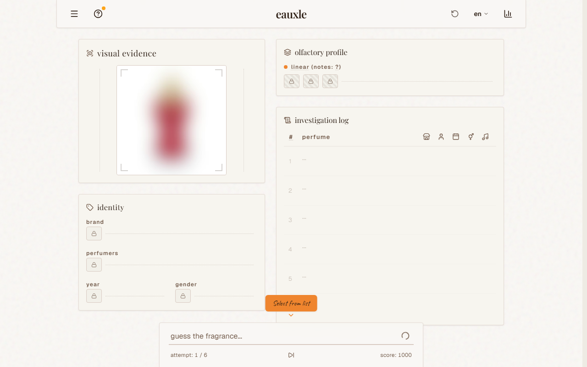

# Eauxle: Olfactory Deduction

A daily puzzle for perfume lovers, inspired by Wordle. Guess the mystery perfume from clues that sharpen with every attempt.

Play at [eauxle.vercel.app](https://eauxle.vercel.app).



## Status

The game is live with a new puzzle every day, in English and Polish; you can play without an account. The latest release is [0.9.0](https://github.com/visvaya/fragrance-game/releases/tag/v0.9.0) (2026-09-27); the project is under active development, so gameplay and interface may still change before 1.0. Only the deployed version built from `main` receives fixes (see [docs/SECURITY.md](./docs/SECURITY.md)).

## How it works

**Eauxle** (pronounced "oksle") has one new perfume per day and six attempts. Each wrong guess or skip reveals more:

- Brand and perfumer (letters revealed progressively)
- Release year
- Fragrance notes (top, heart, base)
- Bottle image (progressively unblurred)
- Gender

Fewer attempts give a higher score; harder perfumes earn a bonus.

## Getting started

### Requirements

- Node.js and pnpm in the versions set by `engines` and `packageManager` in `package.json`
- A Supabase project (database, auth) and an Upstash Redis instance (rate limiting)

### Setup

```bash
pnpm install
cp .env.example .env.local   # fill in the values; lib/env.ts validates them at startup
pnpm dev                     # http://localhost:3000
```

### Quality checks

```bash
pnpm typecheck
pnpm lint:strict
pnpm format:check
pnpm test            # unit and component tests (Vitest)
pnpm test:e2e        # end-to-end tests (Playwright)
```

Contributions are welcome: see [CONTRIBUTING.md](./CONTRIBUTING.md).

## Tech stack

- **Framework**: Next.js 16 (App Router, Server Actions), React 19 with the React Compiler
- **UI**: shadcn/ui, Radix primitives, Tailwind CSS v4 (OKLCH colors)
- **Backend**: Supabase (PostgreSQL, Auth, row-level security), Upstash Redis
- **i18n**: next-intl (English, Polish)
- **Monitoring**: Sentry, PostHog, Vercel Speed Insights
- **Deployment**: Vercel, with a daily cron job that picks the next challenge

## Project structure

```text
app/            Next.js routes ([locale]/), server actions, API routes (cron)
components/     game components, shadcn/ui primitives, providers
lib/            game logic (scoring, reveal), Supabase clients, validation
messages/       translations (en.json, pl.json)
supabase/       migrations, pgTAP tests
e2e/            Playwright tests
scripts/        data pipeline (Python ETL) and tooling
```

## Security

See [docs/SECURITY.md](./docs/SECURITY.md) for how to report a vulnerability.

## License

Apache License 2.0. See [LICENSE](./LICENSE).
